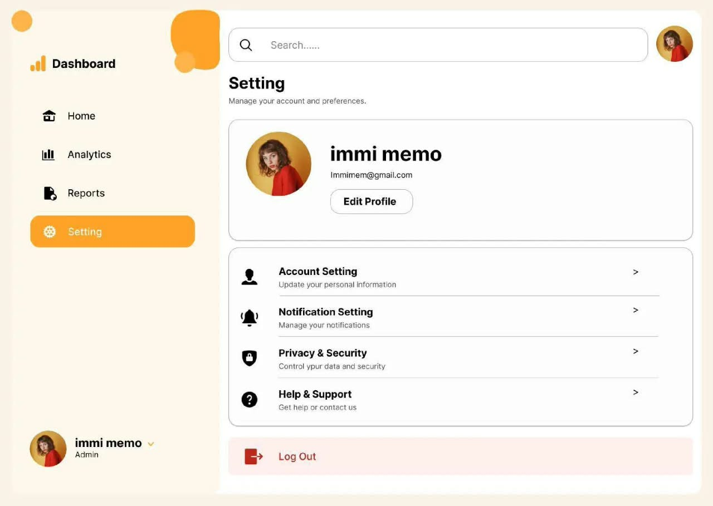
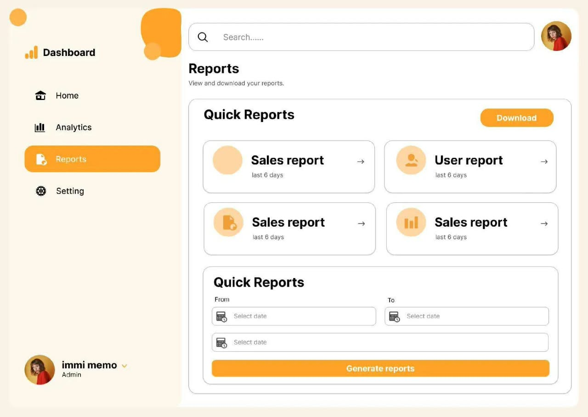

# Fintech Dashboard

A static dashboard UI for a fintech/business app. The current work is focused on building the **Settings** and **Reports** screens to match the supplied design references.

## Project status

- `index.html` contains the dashboard page markup.
- `settings.html` and `reports.html` reuse the dashboard sidebar and search/profile header. Their main content areas are ready for the page-specific features.
- `css/style.css` contains the shared dashboard styles.
- The project currently has no JavaScript file or build system. The screens are HTML and CSS prototypes; do not assume that forms, search, downloads, or navigation are functional.

## Design references

Use these images as the visual source of truth for the two screens in progress:

### Settings



The design includes a dashboard sidebar, a search/profile header, a page title and description, a profile card with an Edit Profile button, account/notification/privacy/help rows, and a Log Out action.

### Reports



The design includes the same dashboard navigation and header, a Quick Reports area with report cards and a Download button, and a date-range form with a Generate reports button.

The screenshot images are references only; they are not page content to embed as the finished UI.

## Files and folders

```text
Fintech-App/
├── index.html
├── reports.html
├── settings.html
├── css/
│   └── style.css
└── assests/
    ├── codes/
    │   └── resources.txt
    └── images/
        ├── analytics.jpeg
        ├── create account.jpeg
        ├── home.jpeg
        ├── login.jpeg
        ├── nature.jpg
        ├── reports.jpeg
        └── settings.jpeg
```

> The folder is currently named `assests` (misspelled). Keep paths consistent with that name unless intentionally renaming the directory and updating every reference.

## Running locally

No dependencies or compilation are required. Open `index.html` directly in a browser, or serve the `Fintech-App` folder with a local static server / VS Code Live Server. Open `settings.html` or `reports.html` to add page-specific content.

## Notes for contributors and coding agents

- Keep the implementation in plain HTML and CSS unless the project requirements change.
- Reuse `css/style.css` for shared layout and visual styles; keep page-specific styles organized and avoid duplicating shared navigation/header rules.
- Use the existing `assests/images/` paths for local images. `nature.jpg` is currently used for the profile avatar in `index.html`.
- Match the provided screenshots, including their warm cream background, orange accents, rounded cards, and left-side navigation. Check the layout at narrow and wide viewport sizes.
- The sidebar links in `index.html` currently point to pages that are not present in the project. Do not describe those destinations as implemented unless their pages are added.
- `index.html` references `script.js`, but no such file currently exists. Avoid adding a script dependency unless implementing a specific interaction.
- There is no automated test or build command configured. Verify UI work by opening the relevant page in a browser and checking the layout and local asset loading.
